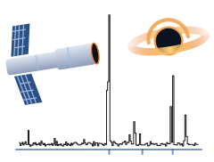
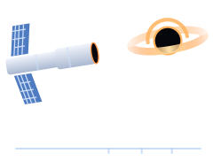

```@raw html


```

# Radix.jl

A spectral simulator for photo-ionized plasmas at X-ray frequencies.

Radix is based on Tim Kallman's XSTAR program, which is written in Fortran. A Julia version is more modular, extendable and
performant: the rates of the atomic processes, the level balance, the thermal equilibrium, the transfer of the radiation through a
slab and the emitted spectrum are separate functions that return arrays, and the results can be used as a model of a spectral fit
or written to one FITS file. Each step has been validated against XSTAR 2.59j.

## Quick start

```julia
using Radix
model = Model("atdb.fits", "coheat.dat")        # the atomic data and the Compton table of an XSTAR installation
run = slab(model; density=1e4, column=1e21, logξ=1.0, luminosity=1e46, equilibrium=true, T=10.0, emult=1.0, steps=3, vturb=0.0)
[(z.T, z.xee, z.Δr) for z in run.zones]         # the zones: temperature (10⁴ K), electron fraction and thickness (cm)
```

Start Julia with several threads (`julia -t auto`): the elements of the gas are solved in parallel.

## Contents

```@contents
Pages = ["usage.md", "api.md", "field-names.md"]
Depth = 2
```
